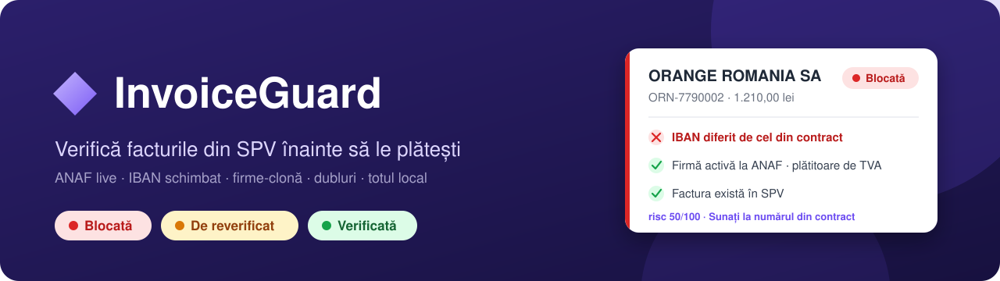
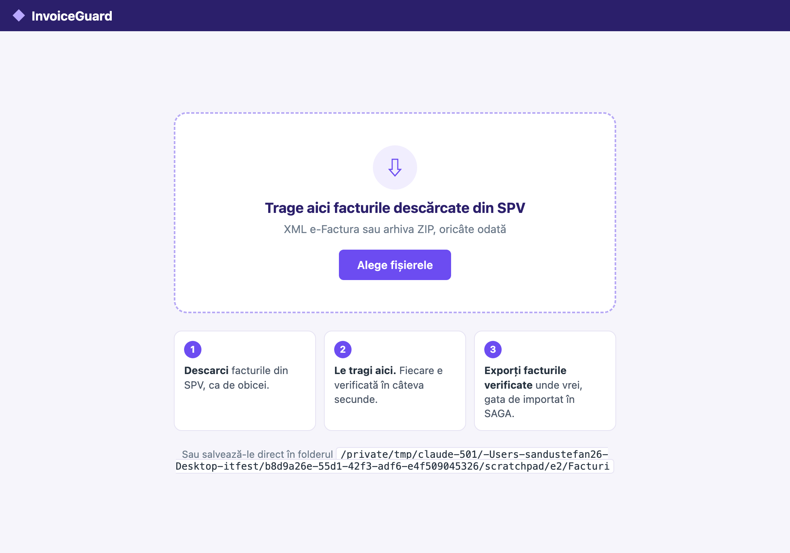
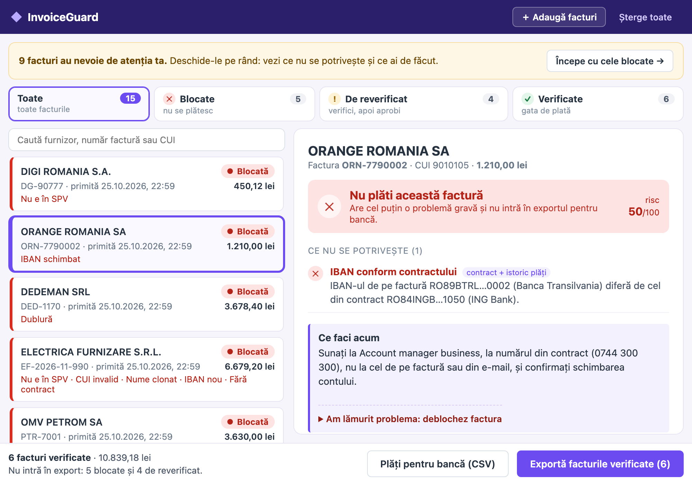
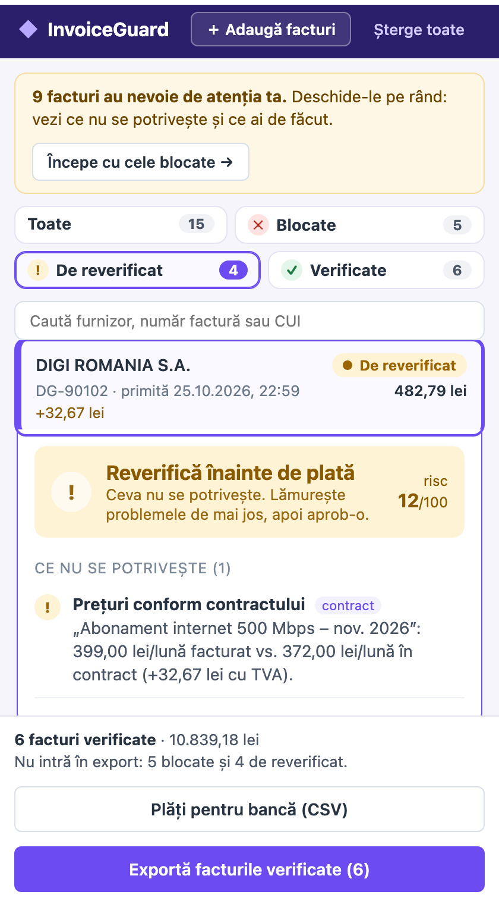
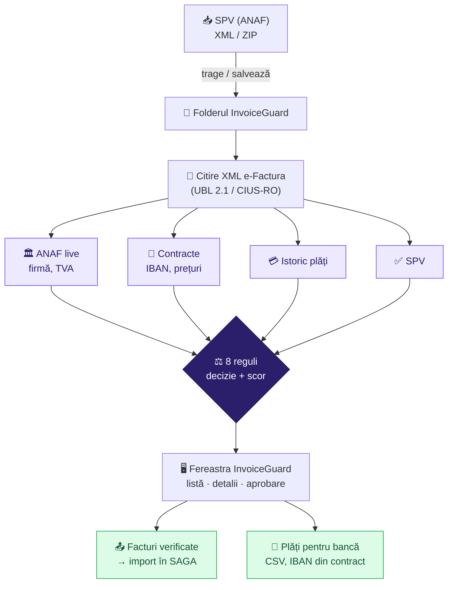

<p align="center">
  
</p>

<p align="center">
  
  
  
  
  
  
</p>

<p align="center">
  <a href="#-ce-face"><b>Ce face</b></a> ·
  <a href="#-cum-arată"><b>Cum arată</b></a> ·
  <a href="#-instalare"><b>Instalare</b></a> ·
  <a href="#-cum-se-folosește"><b>Cum se folosește</b></a> ·
  <a href="#-ce-verifică"><b>Ce verifică</b></a> ·
  <a href="#️-cum-funcționează"><b>Cum funcționează</b></a>
</p>

---

## 🧾 Ce face

Firmele pierd bani pe facturi false sau greșite: un IBAN „schimbat” de un escroc, o firmă care imită un furnizor cunoscut,
o factură plătită de două ori. **InvoiceGuard** este o fereastră care stă lângă programul de contabilitate (SAGA, WinMentor)
și verifică fiecare factură primită **înainte** să fie plătită.

> [!IMPORTANT]
> **e-Factura garantează că factura e completă. InvoiceGuard verifică dacă e datorată.**

Contabilul trage facturile descărcate din SPV în fereastră, iar în câteva secunde fiecare primește un verdict clar:

<table>
  <tr>
    <td align="center" width="33%">
      <h3>🔴 Blocată</h3>
      Are o problemă gravă.<br>Nu se plătește și nu intră în export.
    </td>
    <td align="center" width="33%">
      <h3>🟡 De reverificat</h3>
      Ceva nu se potrivește.<br>Contabilul verifică și aprobă manual.
    </td>
    <td align="center" width="33%">
      <h3>🟢 Verificată</h3>
      Totul se potrivește.<br>Gata de plată și de importat în SAGA.
    </td>
  </tr>
</table>

### ✨ Pe scurt

<table>
  <tr>
    <td width="33%" valign="top">
      <h4>🔍 Firma, live la ANAF</h4>
      Există, e activă, numele corespunde CUI-ului, e plătitoare de TVA.
    </td>
    <td width="33%" valign="top">
      <h4>🏦 IBAN-ul schimbat</h4>
      Compară contul de pe factură cu cel din contract și din plățile anterioare.
    </td>
    <td width="33%" valign="top">
      <h4>🎭 Firmele-clonă</h4>
      „Dedeman Distributie SRL” cu alt CUI decât furnizorul vostru Dedeman.
    </td>
  </tr>
  <tr>
    <td width="33%" valign="top">
      <h4>🔁 Dubluri și sume ciudate</h4>
      Aceeași factură plătită de două ori sau o sumă de 3× media lunară.
    </td>
    <td width="33%" valign="top">
      <h4>💬 Explică fiecare decizie</h4>
      Pe înțelesul contabilului, cu ce are de făcut: „sunați la numărul din contract”.
    </td>
    <td width="33%" valign="top">
      <h4>📤 Export doar ce e verificat</h4>
      Facturile, exact cum au venit din SPV, gata de importat în SAGA.
    </td>
  </tr>
</table>

---

## 📸 Cum arată

<table>
  <tr>
    <td width="50%"></td>
    <td width="50%"></td>
  </tr>
  <tr>
    <td align="center"><sub><b>1.</b> La pornire: tragi facturile din SPV în mijlocul ferestrei</sub></td>
    <td align="center"><sub><b>2.</b> Filtre, listă și detaliile facturii alese, fără pop-up-uri</sub></td>
  </tr>
</table>

<p align="center">
  <br>
  <sub><b>3.</b> Îngustată lângă SAGA, detaliile se deschid sub factură</sub>
</p>

---

## ⚡ Instalare

Ai nevoie doar de **Python**. Prima pornire instalează singură restul (1–2 minute, cu internet).

### 🪟 Windows

1. Instalează **Python 3.12 sau 3.13** de pe [python.org](https://www.python.org/downloads/).
   La instalare, bifează **„Add python.exe to PATH”**.
2. Descarcă proiectul: butonul verde **Code → Download ZIP** de pe această pagină, apoi dezarhivează-l.
3. Dă dublu-click pe **`run-desktop.bat`**.

### 🍎 macOS

1. Verifică dacă ai Python: în Terminal, `python3 --version` (trebuie 3.9 sau mai nou).
   Dacă nu, instalează-l de pe [python.org](https://www.python.org/downloads/).
2. Descarcă proiectul (**Code → Download ZIP**) și dezarhivează-l.
3. Dă dublu-click pe **`InvoiceGuard Desktop.command`**.

> [!NOTE]
> Se deschide și o fereastră neagră (Terminal / Command Prompt): ea ține aplicația pornită. Dacă o închizi, se închide și InvoiceGuard.

<details>
<summary><b>Din linia de comandă</b> (pentru dezvoltatori)</summary>

```bash
git clone https://github.com/Stevenenson/invoice-guard.git
cd invoice-guard
./run-desktop.sh            # macOS / Linux; pe Windows: run-desktop.bat
```

Sau manual:

```bash
python3 -m venv .venv
.venv/bin/pip install -r backend/requirements.txt -r desktop/requirements.txt
.venv/bin/python -m desktop
```
</details>

---

## 🧭 Cum se folosește

**1. Adaugă facturile.** Descarcă facturile din SPV, ca de obicei (XML sau arhiva ZIP). Trage-le în mijlocul ferestrei
sau apasă **Alege fișierele**. Poți adăuga oricând altele cu **＋ Adaugă facturi** sau trăgându-le oriunde în fereastră.

**2. Citește rezumatul.** Banda de sus îți spune câte facturi au nevoie de atenție și te duce direct la ele
(**Începe cu cele blocate →**). Facturile cu probleme sunt mereu primele în listă.

**3. Folosește filtrele.** **Blocate** · **De reverificat** · **Verificate**, plus căutarea după furnizor, număr sau CUI.

**4. Deschide o factură.** Detaliile apar lângă listă, în ordinea în care lucrezi:
- **verdictul** și scorul de risc;
- **ce nu se potrivește**, cu valorile concrete (de exemplu: „IBAN-ul de pe factură diferă de cel din contract”);
- **ce faci acum** (de exemplu: „Sunați la numărul din contract, nu la cel de pe factură”);
- sub **Toate verificările**: fiecare verificare, cu sursa ei, și datele primite de la ANAF.

**5. Decide.**
- 🟡 După ce ai lămurit problema, apasă **Am verificat, aprob plata**. Factura trece la *Verificate* și se deschide următoarea.
- 🔴 O factură blocată nu se plătește. Doar dacă ai verificat în afara aplicației (ai sunat furnizorul), o poți debloca
  din **Am lămurit problema: deblochez factura**, cu un motiv scris obligatoriu.

**6. Exportă.**
- **Exportă facturile verificate**: alegi folderul, iar fiecare factură se salvează exact cum a venit din SPV.
  De acolo o imporți în SAGA. Blocatele nu ajung niciodată în folder.
- **Plăți pentru bancă (CSV)**: fișierul de plăți pentru banca online, cu IBAN-ul **din contract**, nu cel de pe factură.

**7. O iei de la capăt.** **Șterge toate** golește lista. Fiecare pornire a aplicației începe oricum cu lista goală.
Nimic nu se pierde: fișierele șterse se mută în folderul `Sterse`.

> [!TIP]
> Vrei fereastra lipită lângă SAGA? Îngust-o: sub ~760 px, detaliile se deschid sub factură.
> Butonul 📌 din colțul dreapta-sus o ține mereu deasupra.

---

## 🔍 Ce verifică

| Verificare | Cu ce compară | 🔴 Blocată dacă… | 🟡 De reverificat dacă… |
|---|---|---|---|
| **Firma la ANAF** | ANAF, **live** | CUI invalid sau inexistent, firmă radiată / inactivă, numele nu corespunde CUI-ului, TVA facturat fără înregistrare | ANAF nu răspunde; firma are sub 180 de zile |
| **IBAN** | contract + plăți anterioare | IBAN invalid, diferit de cel cunoscut, sau străin la un furnizor nou | IBAN nou, fără cu ce să-l compari |
| **Nume clonat** | furnizorii cu contract + ANAF | seamănă cu un furnizor cunoscut, are alt CUI și e o firmă nouă / inactivă | seamănă, dar e o firmă veche și activă (poate fi din același grup) |
| **Factura e în SPV** | SPV | nu apare în SPV | |
| **Dublură** | istoricul plăților | același număr, deja plătit | aceeași sumă, plătită în ultimele 35 de zile |
| **Contract** | contractele firmei | | furnizorul nu are contract |
| **Prețuri** | contractul, pe fiecare articol | | preț peste contract (cu diferența în lei) sau articol nou |
| **Sumă** | media ultimelor 6 plăți | | factura e de cel puțin 2× media |

**Decizia:** orice 🔴 → *Blocată* · orice 🟡 → *De reverificat* · altfel → *Verificată*.

**Scorul de risc (0–100):** 35 de puncte pentru fiecare 🔴 și 12 pentru fiecare 🟡. O factură verde are 0,
una blocată are cel puțin 50, una de reverificat cel mult 49.

<details>
<summary><b>Cum vorbește cu ANAF</b></summary>

- Folosește serviciul public ANAF pentru registrul plătitorilor de TVA (`webservicesp.anaf.ro/api/PlatitorTvaRest/v9/tva`), fără cont și fără certificat.
- Cere situația firmei la data de azi și citește: denumirea, data înregistrării, TVA, starea de inactiv, radierea.
- Respectă limitele ANAF: maximum 100 de CUI-uri pe cerere și o cerere pe secundă.
- Păstrează răspunsurile 6 ore. Dacă ANAF nu răspunde, folosește ultimul răspuns salvat.
- Cifra de control a CUI-ului și validitatea IBAN-ului se verifică local, fără internet.
</details>

---

## 🏗️ Cum funcționează



Totul rulează **local, pe calculatorul contabilului**. Singura conexiune externă este interogarea ANAF.

### Unde stau fișierele

| Folder | Ce conține |
|---|---|
| `~/InvoiceGuard/Facturi` | facturile din lista curentă (golit la fiecare pornire) |
| `~/InvoiceGuard/Sterse` | facturile șterse sau rămase de data trecută (se pot recupera) |
| `~/InvoiceGuard/Plati` | fișierele de plăți pentru bancă (CSV) |
| folderul ales de tine | facturile verificate, exportate pentru SAGA |

Pe Windows, `~` este `C:\Users\<nume>`. Folderul se poate schimba cu variabila `INVOICEGUARD_INBOX`, iar portul (implicit 8765) cu `INVOICEGUARD_PORT`.

---

## 🧪 Încearcă cu facturile de test

În [`samples/teste`](samples/teste) sunt 15 facturi e-Factura de test (și toate într-o arhivă: [`samples/facturi-test.zip`](samples/facturi-test.zip)).
Numele fișierului spune rezultatul așteptat:

| Fișiere | Rezultat | Exemple |
|---|---|---|
| `verde-*` | 🟢 Verificată | abonamente, energie, materiale la prețul din contract |
| `galben-*` | 🟡 De reverificat | preț peste contract, sumă de 3× media, furnizor nou fără contract |
| `rosu-*` | 🔴 Blocată | IBAN schimbat, dublură deja plătită, CUI invalid, nume Petrom cu CUI-ul Altex |

Detaliile fiecăreia sunt în [`samples/teste/CITESTE.md`](samples/teste/CITESTE.md).

---

## ⚠️ Ce e real și ce e simulat

| Real | Simulat (date de test, în `backend/seed.py`) |
|---|---|
| ✅ Verificarea live la ANAF | 🧪 Lista facturilor din SPV (accesul real cere certificatul digital al firmei) |
| ✅ CUI-urile furnizorilor (DIGI, Orange, eMAG, Dedeman, Electrica, Petrom, Altex) | 🧪 Contractele: IBAN, prețuri, persoane de contact |
| ✅ Cifra de control a CUI-ului și validitatea IBAN-ului | 🧪 Istoricul plăților |
| ✅ Formatul oficial e-Factura (UBL / CIUS-RO) | 🧪 Facturile de test și firma care le primește („Atelier Nord SRL”) |

Firmele „escroc” din scenarii sunt fictive, ca să nu prezentăm o firmă reală drept fraudă.
Într-o firmă reală, contractele și istoricul s-ar încărca din documentele și extrasele ei.

---

## 🩺 Probleme frecvente

<details>
<summary><b>macOS nu vrea să deschidă <code>InvoiceGuard Desktop.command</code></b></summary>

Click dreapta pe fișier → **Deschide** → confirmă. De la a doua pornire merge cu dublu-click.
</details>

<details>
<summary><b>Pe Windows nu apare fereastra</b></summary>

Fereastra folosește **Microsoft Edge WebView2**, inclus în Windows 11 și în Windows 10 actualizat.
Dacă lipsește, se instalează gratuit de pe site-ul Microsoft. Folosește Python 3.12 sau 3.13.
</details>

<details>
<summary><b>Dialogul de alegere a fișierelor apare în spatele ferestrei</b></summary>

Se întâmplă doar dacă fereastra e „mereu deasupra”. Apasă 📌 ca s-o dezactivezi.
</details>

<details>
<summary><b>O factură reală iese mereu „Blocată”</b></summary>

În demo, lista SPV și contractele sunt de test: o factură reală nu e în lista SPV simulată și nu are contract.
Vezi secțiunea **Ce e real și ce e simulat** de mai sus.
</details>

---

## 🛠️ Tehnologii

| Componentă | Tehnologie |
|---|---|
| Fereastra desktop | [pywebview](https://pywebview.flowrl.com/) (WebView2 pe Windows, WebKit pe macOS) |
| Interfața | HTML, CSS și JavaScript, fără framework |
| Server local | Python, FastAPI, Uvicorn |
| Citirea facturilor | XML e-Factura (UBL 2.1 / CIUS-RO), cu `defusedxml` |
| Date despre firme | API-ul public ANAF (registrul plătitorilor de TVA) |
| Notificări | Centrul de notificări (macOS), notificări din bara de sistem (Windows) |

## 📂 Structura proiectului

```
├── desktop/
│   ├── __main__.py        # fereastra aplicației, dialogurile de fișiere, exportul
│   └── web/               # interfața: index.html, desktop.css, desktop.js
├── backend/
│   ├── rules.py           # regulile de verificare, decizia și scorul
│   ├── anaf.py            # clientul ANAF (cache 6 ore, 1 cerere/secundă)
│   ├── efactura.py        # citirea XML-ului e-Factura
│   ├── inbox.py           # folderul cu facturi: scanare, ștergere, export
│   ├── main.py            # serverul local (FastAPI)
│   └── seed.py            # datele de test: contracte, plăți, SPV
├── samples/teste/         # 15 facturi de test
├── run-desktop.bat        # pornire Windows
└── InvoiceGuard Desktop.command   # pornire macOS
```

Proiectul mai conține un demo web și o extensie Chrome pentru softurile online (SAGA WEB).
Detaliile, API-ul și modul de lucru în echipă sunt în [`docs/dezvoltare.md`](docs/dezvoltare.md).

---

## 🏆 Context

**Eveniment:** ITFest 2026 · Provocarea 4: verificarea facturilor înainte de plată

**Ce am construit:**
- O aplicație desktop care verifică facturile e-Factura cu 8 reguli explicabile, inclusiv interogarea live la ANAF
- O interfață gândită pentru un contabil care o deschide prima dată: import în centru, filtre, explicații, fără pop-up-uri
- Exportul facturilor verificate pentru SAGA și al plăților pentru bancă
- Un demo web și o extensie Chrome pentru softurile de facturare online

---

<p align="center">
  
  
</p>

<p align="center">
  <sub>Construit cu ☕ la ITFest 2026 de <a href="https://github.com/Stevenenson">Sandu Stefan</a></sub>
</p>
